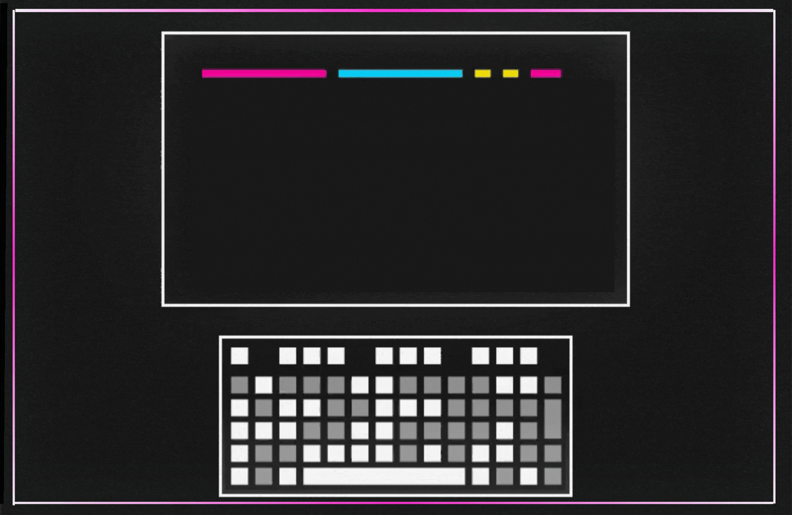

<!-- TÍTULO DE PRESENTACIÓN -->
<h3>Imanol Romero Blanco — Portafolio Profesional</h3>

<!-- GIF PRINCIPAL DE IMANOL -->

 

---

## `$ cat tech-stack.yaml`

<table border="1" cellpadding="14" bgcolor="#17171c">
  <thead>
    <tr>
      <th colspan="2" align="left"><code>ImRomeroBl:~$ cat tech-stack.yaml</code></th>
    </tr>
  </thead>
  <tbody>
    <tr>
      <td width="50%" valign="top"><code>├─ ✦ frontend_mobile:</code>  
         
        <code>JavaScript · TypeScript · React · React Native · Expo · Tailwind</code>
      </td>
      <td width="50%" valign="top"><code>├─ 🎨 design_ux_ui:</code>  
         
        <code>Figma · Prototyping · Wireframing · Design Systems</code>
      </td>
    </tr>
    <tr>
      <td valign="top"><code>├─ ⚙ desktop_languages:</code>  
         
        <code>Python · Kotlin · CustomTkinter · Git · GitHub · VS Code</code>
      </td>
      <td valign="top"><code>├─ 🧠 software_architecture:</code>  
         
        <code>Ontologías · Owlready2 · MVC · Documentación · Planeación</code>
      </td>
    </tr>
    <tr>
      <td colspan="2" valign="top"><code>├─ 🏥 featured_project: Sistema Clínico Basado en Ontologías</code>  
        <code>Sistema inteligente desarrollado en Python, CustomTkinter y Owlready2 para la gestión estructurada de historiales clínicos, consultas médicas y recetas personalizadas por paciente.</code>
      </td>
    </tr>
  </tbody>
  <tfoot>
    <tr>
      <td colspan="2"><code>status: ready&nbsp;&nbsp;·&nbsp;&nbsp;environment: buap-puebla</code></td>
    </tr>
  </tfoot>
</table>

---

## `$ git status --featured-skills`

  <picture>
    <source media="(prefers-color-scheme: dark)" srcset="assets/radar-dark.svg">
    <source media="(prefers-color-scheme: light)" srcset="assets/radar-light.svg">
    
  </picture>&nbsp;
  <picture>
    <source media="(prefers-color-scheme: dark)" srcset="assets/radar-langs-dark.svg">
    <source media="(prefers-color-scheme: light)" srcset="assets/radar-langs-light.svg">
    
  </picture>

<code>signals: frontend_skill_radar · architecture_stack_radar · status: healthy</code>

---

<!-- SOCIALS -->
## `$ connect --socials`

&nbsp;&nbsp;
&nbsp;&nbsp;

 
 

Hecho con 💜 y café desde Puebla, México · BUAP · @ImRomeroBl

